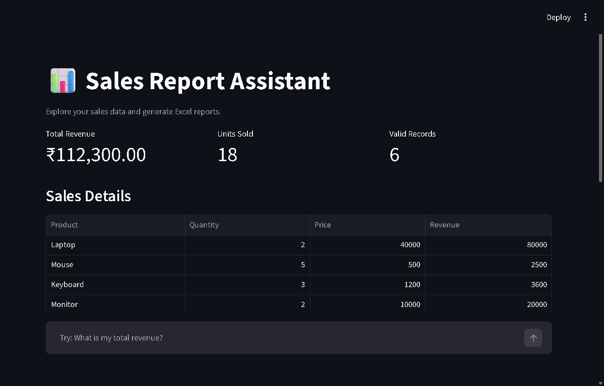
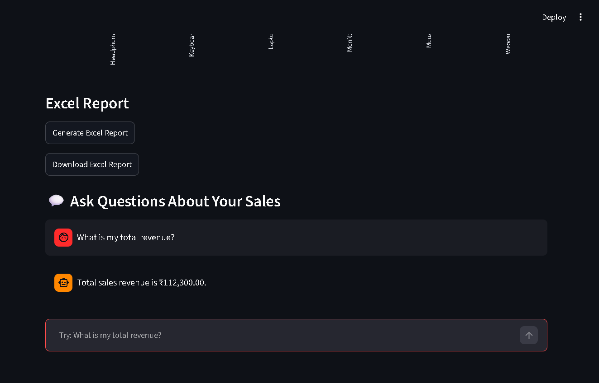
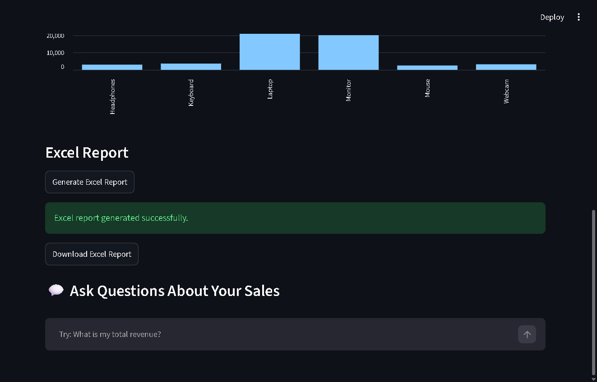

# Sales Report Automation

A beginner-friendly Python project that validates sales data from a CSV file
and generates a formatted Excel sales report.

## Features

- Reads sales records from a CSV file
- Detects missing and invalid values
- Removes exact duplicate records
- Calculates revenue for each sale and product
- Generates a formatted Excel workbook with summary and detail sheets
- Provides an interactive sales dashboard using Streamlit
- Includes a chat interface for asking basic questions about sales data
- Displays sales metrics and product-wise revenue charts
- Allows users to download the generated Excel report
- 
## Live Demo

[Launch Sales Report Automation](https://freelancing-39maquehee8xc3hrytytx5.streamlit.app/)

## Technologies

- Python
- CSV module
- Pandas
- OpenPyXL
- Streamlit

## Requirements

- Python 3.8 or newer
- Pandas
- OpenPyXL
- Streamlit

## Installation

Install the required packages:

```powershell
py -m pip install pandas openpyxl streamlit
```

If the `py` command is unavailable, try:

```bash
python -m pip install pandas openpyxl streamlit
```

## Project Structure

```text
sales-report-automation/
├── app.py                  # Streamlit dashboard and chat assistant
├── csv_processor.py        # Validates and cleans sales.csv
├── sales_report.py         # Generates the Excel report
├── sales.csv               # Source sales data
├── README.md               # Project documentation
└── screenshots/
│   ├── dashboard.png       # Streamlit dashboard screenshot
│   ├── chat-assistant.png  # Chat assistant response screenshot
│   └── excel-report.png    # Excel report generation screenshot
```

## Input File Format

The input file must be named `sales.csv` and must be in the same directory as
the Python scripts. It must contain these columns:

```csv
Product,Quantity,Price
Laptop,2,40000
Mouse,5,500
```

- `Product` must not be empty.
- `Quantity` must be a positive whole number.
- `Price` must be a non-negative number.
- Exact duplicate records are skipped.

Invalid rows are reported in the terminal and are not written to
`validated_sales.csv`.

## How to Run

Open a terminal in the project directory:

```powershell
cd "D:\ desktop\freelancing\sales-report-automation"
```

Run the validation step first:

```bash
python csv_processor.py
```

Then generate the Excel report:

```bash
python sales_report.py
```

Alternatively, use `py` instead of `python` on Windows:

```powershell
py csv_processor.py
py sales_report.py
```

Run both commands from the project directory because the scripts use relative
file paths.

## Run the Chat Assistant

First, validate the sales data:

```powershell
py csv_processor.py
```

Then start the Streamlit application:

```powershell
py -m streamlit run app.py
```

Streamlit will provide a local URL, usually
`http://localhost:8501`. Open it in your browser to access the sales
dashboard and chat assistant.

The chat assistant supports basic questions about total revenue, units sold,
valid sales records, and product-wise performance.

## Deploy on Streamlit Community Cloud

This project is ready to deploy on
[Streamlit Community Cloud](https://share.streamlit.io/).

1. Push the `sales-report-automation` folder to a GitHub repository.
2. Sign in to Streamlit Community Cloud with GitHub.
3. Select **Create app** and choose your repository and branch.
4. Set the **Main file path** to:

   ```text
   sales-report-automation/app.py
   ```

5. Click **Deploy**.

The `requirements.txt` file in the project folder installs the required
packages automatically. The app uses the included `sales.csv` file and
automatically creates `validated_sales.csv` if it is missing. Generated Excel
files are temporary on Streamlit Cloud, so download a report before restarting
or redeploying the app.

For a repository where `sales-report-automation` is the repository root, use
`app.py` as the main file path instead.

## Screenshots

The live dashboard includes summary metrics, sales details, product-wise
revenue, Excel report generation and download, and the chat assistant.







## Generated Report

The project creates:

- `validated_sales.csv`, containing only valid, non-duplicate records.
- `sales_report.xlsx`, containing:
  - **Summary**: total revenue, total quantity sold, valid sales records, and
    product-level totals.
  - **Sales Details**: each valid sale with product, quantity, unit price, and
    calculated revenue.

Revenue is calculated as:

```text
Revenue = Quantity × Price
```

## Troubleshooting

- **`FileNotFoundError`**: Confirm that `sales.csv` or
  `validated_sales.csv` is in the project directory and that the terminal is
  open in that directory.
- **`ModuleNotFoundError: No module named 'openpyxl'`**: Install the dependency
  with `python -m pip install openpyxl` or `py -m pip install openpyxl`.
- **`python is not recognized`**: Install Python, enable **Add Python to PATH**
  during installation, or use the `py` command.

## Limitations

- Designed for a simple CSV structure
- Uses local files and sample sales data
- Does not connect to a live business database
- Existing generated files are overwritten when the scripts run

## Future Improvements

- Add graphical charts
- Support more input formats
- Add automated tests

## Project Status

Personal portfolio project using sample sales data. The chat assistant uses
rule-based question matching and does not require a paid AI API.
